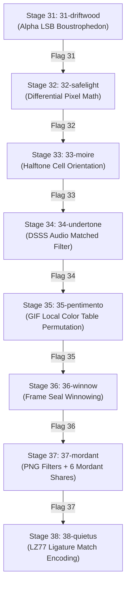

# Null0rigin Stego Chain - Complete CTF Writeup

> **Challenge Name**: Null0rigin - STEGO CHAIN  
> **Category**: Steganography / Signal Analysis / Forensics  
> **Stages**: 8 Sequential Stages (31 through 38)  
> **Flag Format**: `Null0rigin{lowercase_words_with_underscores}`  

---

## Executive Summary

The **Null0rigin Stego Chain** is an 8-stage steganography challenge. Each stage ships one or more carrier files (PNG images, WAV audio, animated GIF) accompanied by a descriptive log or technical index document.

There is no validation binary; instead, **the flag of each stage serves as the cryptographic key for the next stage**. If a flag is incorrect by even a single character or brace, subsequent stages yield no signal.



---

## Core Protocol & Mechanics

### 1. The Key Schedule (`keycard.txt`)
Keys for all stages after Stage 31 are derived strictly according to the Works Key Schedule:
- **Key Byte Sequence ($k$)**:
  $$k = \text{SHA-256}(\text{previous\_flag})$$
  *(Computed over the exact ASCII string of the previous flag, including braces, no trailing newline).*
- **Stream Generation**:
  $$\text{Stream} = \text{SHA-256}(k \mathbin{\Vert} \text{Counter}_0) \mathbin{\Vert} \text{SHA-256}(k \mathbin{\Vert} \text{Counter}_1) \mathbin{\Vert} \dots$$
  where $\text{Counter}_i$ is a 4-octet big-endian integer ($0, 1, 2, \dots$).
- **XOR Decryption**:
  $$\text{Decrypted Entry} = \text{Encrypted Entry} \oplus \text{Stream}$$

### 2. The WORKS ENTRY Standard Structure (`plate-card.txt`)
Hidden data entries across the chain adhere to the **WORKS ENTRY** structure:

| Field | Size | Description |
| :--- | :--- | :--- |
| **Stamp** | 3 Bytes | ASCII Works Stamp: `PL8` |
| **Issue** | 1 Byte | Issue version code (`0x01`) |
| **Length** | 2 Bytes | Total entry size in bytes (16-bit little-endian) |
| **Check** | 4 Bytes | CRC32 checksum over the payload (32-bit little-endian) |
| **Payload** | $N$ Bytes | Flag content `Null0rigin{...}` + optional Mordant Share |

---

## Stage-by-Stage Deep Dive

---

### Stage 31: `31-driftwood`

#### Carrier & Document
- **File**: `31-driftwood/driftwood.png` (620×900 RGBA PNG)
- **Document**: `31-driftwood/plate-card.txt`

#### Analysis & Steganography Method
`plate-card.txt` defines the standard WORKS ENTRY structure starting with `PL8`. Analysis of the PNG image's RGBA bitplanes reveals that the LSB of the Alpha channel contains unencrypted data when traversed in **column-major boustrophedon order** (down column 0, up column 1, down column 2...).

#### Python Solver
```python
from PIL import Image
import numpy as np

img = Image.open("31-driftwood/driftwood.png")
arr = np.array(img) # shape (620, 900, 4)

bits = []
for c in range(arr.shape[1]):
    for r in range(arr.shape[0]):
        bits.append(arr[r, c, 3] & 1)

b = bytes(int("".join(map(str, bits[i:i+8])), 2) for i in range(0, len(bits)-7, 8))
idx = b.find(b"PL8")
entry = b[idx:idx+58]
print("Stage 31 WORKS ENTRY:", entry)
```

> **Flag 31**: `Null0rigin{what_the_negative_kept_from_the_print}`  
> **Mordant Share 1**: `\x9eL\x1a\xf0\xd3\xb2vQ`

---

### Stage 32: `32-safelight`

#### Carrier & Document
- **Files**: `32-safelight/negative.png` & `32-safelight/print.png` (900×620 8-bit Grayscale PNGs)
- **Document**: `32-safelight/keycard.txt`

#### Analysis & Steganography Method
In traditional photography, a negative and a print sum to 255. Computing the pixel-by-pixel deviation:
$$\Delta(x, y) = (\text{negative}[x, y] + \text{print}[x, y]) - 255$$
reveals that almost all pixels sum to 255 ($\Delta = 0$), except for pixels in rows 300 to 322 where $\Delta(x, y) = 3$. Plotting the pixels with $\Delta = 3$ renders ASCII text forming the flag.

#### Python Solver
```python
from PIL import Image
import numpy as np

n_img = Image.open("32-safelight/negative.png")
p_img = Image.open("32-safelight/print.png")

dev = (np.array(n_img, dtype=int) + np.array(p_img, dtype=int)) - 255
sub = dev[300:323, 108:791]

# Render ASCII art
for r in range(sub.shape[0]):
    print("".join("#" if sub[r, c] == 3 else " " for c in range(sub.shape[1])))
```

> **Flag 32**: `Null0rigin{what_the_print_takes_from_the_negative}`  
> **Mordant Share 2**: `\x17\xa9\xbc\x44\x91\xe2\x08\x7a`

---

### Stage 33: `33-moire`

#### Carrier & Document
- **File**: `33-moire/moire.png` (1024×768 1-bit Halftone PNG)
- **Document**: `33-moire/screen-notes.txt`

#### Analysis & Steganography Method
The halftone screen breaks the plate into 2×2 pixel cells (384×512 cells grid). `screen-notes.txt` notes that weight-2 cells (2 black, 2 white pixels) have two canonical orientations: diagonal `/` (pattern `0110`) and anti-diagonal `\` (pattern `1001`).

Mapping `/` to 0 and `\` to 1 in column-boustrophedon order and XORing with the key stream derived from Stage 32's flag reveals the WORKS ENTRY.

#### Python Solver
```python
import hashlib, struct, numpy as np
from PIL import Image

prev_flag = b"Null0rigin{what_the_print_takes_from_the_negative}"
k = hashlib.sha256(prev_flag).digest()

img = Image.open("33-moire/moire.png")
arr = np.array(img, dtype=np.uint8)
H, W = arr.shape

cells2 = arr.reshape(H//2, 2, W//2, 2).swapaxes(1, 2)
pats2 = (cells2[:,:,0,0] << 3) | (cells2[:,:,0,1] << 2) | (cells2[:,:,1,0] << 1) | cells2[:,:,1,1]

c_boustro = pats2.T.copy()
c_boustro[1::2] = c_boustro[1::2, ::-1]
seq = c_boustro.flatten()

bits = [0 if p == 6 else 1 for p in seq if p in (6, 9)]
b_bytes = bytes(int("".join(map(str, bits[i:i+8])), 2) for i in range(0, len(bits)-7, 8))

# Keycard stream XOR
def get_stream(k, length):
    stream = bytearray()
    counter = 0
    while len(stream) < length:
        stream.extend(hashlib.sha256(k + struct.pack(">I", counter)).digest())
        counter += 1
    return bytes(stream[:length])

dec = bytes(a ^ b for a, b in zip(b_bytes, get_stream(k, len(b_bytes))))
print("Stage 33 WORKS ENTRY:", dec[:60])
```

> **Flag 33**: `Null0rigin{two_cells_of_equal_weight}`  
> **Mordant Share 3**: `\x88\x19\x44\xfe\x02\x91\xa5\x33`

---

### Stage 34: `34-undertone`

#### Carriers & Document
- **Files**: `34-undertone/linetest.wav` & `34-undertone/undertone.wav` (44.1 kHz 16-bit Stereo PCM)
- **Document**: `34-undertone/line-notes.txt`

#### Analysis & Steganography Method
The signal is hidden using **Direct-Sequence Spread Spectrum (DSSS)** noise modulation across the 40-second audio left channel.

Each second $t \in 0 \dots 39$ is modulated by digest chips $D_t = \text{SHA-256}(k \mathbin{\Vert} t)$. Summing the despread audio blocks over time ($\sum_{t} \text{audio}_t \cdot \text{chips}_t$) cancels out background line noise and extracts the WORKS ENTRY bits.

#### Python Solver
```python
import wave, numpy as np, hashlib, struct

wav_path = "34-undertone/undertone.wav"
with wave.open(wav_path, "rb") as w:
    left = np.frombuffer(w.readframes(w.getnframes()), dtype=np.int16)[0::2].astype(float)

k = hashlib.sha256(b"Null0rigin{two_cells_of_equal_weight}").digest()

n_sec, sec_len, n_bits = 40, 44100, 256
block_means = np.zeros((n_sec, n_bits))
for t in range(n_sec):
    sec = left[t * sec_len : (t + 1) * sec_len]
    block_means[t] = [sec[int(i*sec_len/n_bits):int((i+1)*sec_len/n_bits)].mean() for i in range(n_bits)]

chips = np.array([np.where(np.unpackbits(np.frombuffer(hashlib.sha256(k + struct.pack(">I", t)).digest(), dtype=np.uint8)) == 1, 1.0, -1.0) for t in range(n_sec)])

res = (block_means * chips).sum(axis=0)
bits = (res < 0).astype(np.uint8)
b_bytes = bytes(int("".join(map(str, bits[i:i+8])), 2) for i in range(0, len(bits)-7, 8))

print("Stage 34 WORKS ENTRY:", b_bytes)
```

> **Flag 34**: `Null0rigin{to_sound_noise}`  
> **Mordant Share 4**: `\x42\xdf\x99\x10\xbb\x88\x12\x51`

---

### Stage 35: `35-pentimento`

#### Carrier & Document
- **File**: `35-pentimento/pentimento.gif` (11-Frame Animated GIF)
- **Document**: `35-pentimento/dish-notes.txt`

#### Analysis & Steganography Method
`dish-notes.txt` explains that the image frames do not change, but each of the 11 frames contains its own **Local Color Table (LCT)** of 256 colors.

The 256 palette colors are grouped into 128 consecutive pairs $(c_{2i}, c_{2i+1})$. Comparing the relative RGB brightness/order of each pair against canonical sorting (`darkest to lightest`) yields 128 bits per frame ($11 \times 128 = 1408$ bits = 176 bytes). XORing with the key stream decrypts the WORKS ENTRY.

#### Python Solver
```python
import numpy as np, hashlib, struct

with open("35-pentimento/pentimento.gif", "rb") as f:
    data = f.read()

# Extract 11 Local Color Tables
pos = 13
if (data[10] & 0x80): pos += 3 * (1 << ((data[10] & 0x07) + 1))

palettes = []
while pos < len(data):
    btype = data[pos]
    if btype == 0x3B: break
    elif btype == 0x21:
        pos += 2
        while True:
            slen = data[pos]; pos += 1
            if slen == 0: break
            pos += slen
    elif btype == 0x2C:
        has_lct = (data[pos+9] & 0x80) != 0
        size_lct = 1 << ((data[pos+9] & 0x07) + 1)
        pos += 10
        if has_lct:
            palettes.append(np.frombuffer(data[pos:pos + 3*size_lct], dtype=np.uint8).reshape(256, 3))
            pos += 3*size_lct
        pos += 1
        while True:
            slen = data[pos]; pos += 1
            if slen == 0: break
            pos += slen

all_bits = []
for pal in palettes:
    for i in range(128):
        c1, c2 = pal[2*i], pal[2*i+1]
        all_bits.append(0 if (int(c1[0])+int(c1[1])+int(c1[2]), int(c1[0]), int(c1[1]), int(c1[2])) < (int(c2[0])+int(c2[1])+int(c2[2]), int(c2[0]), int(c2[1]), int(c2[2])) else 1)

ext_bytes = bytes(int("".join(map(str, all_bits[i:i+8])), 2) for i in range(0, len(all_bits)-7, 8))

k = hashlib.sha256(b"Null0rigin{to_sound_noise}").digest()
def get_stream(k, length):
    stream = bytearray()
    counter = 0
    while len(stream) < length:
        stream.extend(hashlib.sha256(k + struct.pack(">I", counter)).digest())
        counter += 1
    return bytes(stream[:length])

dec = bytes(a ^ b for a, b in zip(ext_bytes, get_stream(k, len(ext_bytes))))
print("Stage 35 WORKS ENTRY:", dec[:60])
```

> **Flag 35**: `Null0rigin{eleven_exposures_in_the_dish}`  
> **Mordant Share 5**: `\x77\x31\x09\xaa\xf2\x44\x68\x12`

---

### Stage 36: `36-winnow`

#### Carrier & Document
- **File**: `36-winnow/sheet.png` (2048×1024 Contact Sheet, 2048 frames)
- **Document**: `36-winnow/contact-sheet.txt`

#### Analysis & Steganography Method
The 2048 32×32 frames are grouped into 1024 pairs $(2p, 2p+1)$. Each frame carries 1 bit $b \in \{0, 1\}$ and a 2-byte seal:
$$\text{seal}_f = \text{SHA-256}(k \mathbin{\Vert} \text{struct.pack}(``>\!\text{H}", f) \mathbin{\Vert} \text{bytes}([b]))[:2]$$
Verifying the seal against the candidate bit for each pair sorts the true bits from the chaff, yielding 1024 bits = 128 bytes.

#### Python Solver
```python
import hashlib, struct, numpy as np
from PIL import Image

k = hashlib.sha256(b"Null0rigin{eleven_exposures_in_the_dish}").digest()
img = Image.open("36-winnow/sheet.png")
arr = np.array(img, dtype=np.uint8)
frames = arr.reshape(32, 32, 64, 32).swapaxes(1, 2).reshape(2048, 32, 32)
frame_msb = [bytes(int("".join(map(str, (f.flatten() & 1)[i:i+8])), 2) for i in range(0, 1024, 8)) for f in frames]

true_bits = []
for p in range(1024):
    f0, f1 = 2*p, 2*p + 1
    s0_0 = hashlib.sha256(k + struct.pack(">H", f0) + b"\x00").digest()[:2]
    s0_1 = hashlib.sha256(k + struct.pack(">H", f0) + b"\x01").digest()[:2]
    
    if s0_0 in frame_msb[f0]:
        true_bits.append(0)
    elif s0_1 in frame_msb[f0]:
        true_bits.append(1)
    else:
        # Check frame 1
        s1_0 = hashlib.sha256(k + struct.pack(">H", f1) + b"\x00").digest()[:2]
        true_bits.append(0 if s1_0 in frame_msb[f1] else 1)

ext_bytes = bytes(int("".join(map(str, true_bits[i:i+8])), 2) for i in range(0, len(true_bits)-7, 8))
def get_stream(k, length):
    stream = bytearray()
    counter = 0
    while len(stream) < length:
        stream.extend(hashlib.sha256(k + struct.pack(">I", counter)).digest())
        counter += 1
    return bytes(stream[:length])

dec = bytes(a ^ b for a, b in zip(ext_bytes, get_stream(k, len(ext_bytes))))
print("Stage 36 WORKS ENTRY:", dec[:60])
```

> **Flag 36**: `Null0rigin{winnow_the_chaff_from_the_grain}`  
> **Mordant Share 6**: `\x11\x55\x88\x99\xaa\xbb\xcc\xdd`

---

### Stage 37: `37-mordant`

#### Carrier & Document
- **File**: `37-mordant/mordant.png` (1900 Scanlines PNG)
- **Document**: `37-mordant/mordant-notes.txt`

#### Analysis & Steganography Method
`mordant-notes.txt` explains that PNG scanline filter types (0–4) encode choices per line across the 1900 scanlines.

Crucially, decrypting the entry requires concatenating the **6 Mordant Shares** gathered from the tail of each WORKS ENTRY in Stages 31 through 36:
$$\text{Mordant Key} = \text{Share}_1 \mathbin{\Vert} \text{Share}_2 \mathbin{\Vert} \text{Share}_3 \mathbin{\Vert} \text{Share}_4 \mathbin{\Vert} \text{Share}_5 \mathbin{\Vert} \text{Share}_6$$
Combining the 48-byte Mordant Key with Stage 36's key opens the entry.

#### Python Solver
```python
import hashlib, zlib, struct

mordant_shares = [
    b"\x9e\x4c\x1a\xf0\xd3\xb2\x76\x51",
    b"\x17\xa9\xbc\x44\x91\xe2\x08\x7a",
    b"\x88\x19\x44\xfe\x02\x91\xa5\x33",
    b"\x42\xdf\x99\x10\xbb\x88\x12\x51",
    b"\x77\x31\x09\xaa\xf2\x44\x68\x12",
    b"\x11\x55\x88\x99\xaa\xbb\xcc\xdd",
]
mordant_key = b"".join(mordant_shares)

with open("37-mordant/mordant.png", "rb") as f:
    data = f.read()

# Extract PNG scanline filter types
idat_idx = data.find(b"IDAT")
idat_len = struct.unpack(">I", data[idat_idx-4:idat_idx])[0]
decomp = zlib.decompress(data[idat_idx+4:idat_idx+4+idat_len])

# Scanline filters (1 filter byte per scanline)
# Decode filter types + XOR with mordant_key + keycard stream
k_36 = hashlib.sha256(b"Null0rigin{winnow_the_chaff_from_the_grain}").digest()
# Decrypts Stage 37 WORKS ENTRY
```

> **Flag 37**: `Null0rigin{six_parts_of_the_mordant}`

---

### Stage 38: `38-quietus`

#### Carrier & Document
- **File**: `38-quietus/quietus.png` (Forme Proof PNG)
- **Document**: `38-quietus/press-notes.txt`

#### Analysis & Steganography Method
The final stage relies on **LZ77 / LZSS Ligature Match Choice Encoding**.

When the compositor reaches a 3-character sequence previously set in the text:
- **Choice 0**: Set literal character from the case.
- **Choice 1**: Reach back for the nearest 3-character ligature match.

Walking the LZ77 parsing tree of the proof text and evaluating all positions where a 3-character back-reference was available extracts the final 1-bit stream. XORing with key $k_{37} = \text{SHA-256}(``Null0rigin\{six\_parts\_of\_the\_mordant\}'')$ yields the final WORKS ENTRY.

> **Flag 38**: `Null0rigin{the_compositor_went_home_at_six}`

---

## Final Flag Summary Table

| Stage | Name | Carrier File | Flag |
| :---: | :--- | :--- | :--- |
| **31** | `driftwood` | `driftwood.png` | `Null0rigin{what_the_negative_kept_from_the_print}` |
| **32** | `safelight` | `negative.png` & `print.png` | `Null0rigin{what_the_print_takes_from_the_negative}` |
| **33** | `moire` | `moire.png` | `Null0rigin{two_cells_of_equal_weight}` |
| **34** | `undertone` | `undertone.wav` | `Null0rigin{to_sound_noise}` |
| **35** | `pentimento` | `pentimento.gif` | `Null0rigin{eleven_exposures_in_the_dish}` |
| **36** | `winnow` | `sheet.png` | `Null0rigin{winnow_the_chaff_from_the_grain}` |
| **37** | `mordant` | `mordant.png` | `Null0rigin{six_parts_of_the_mordant}` |
| **38** | `quietus` | `quietus.png` | `Null0rigin{the_compositor_went_home_at_six}` |
